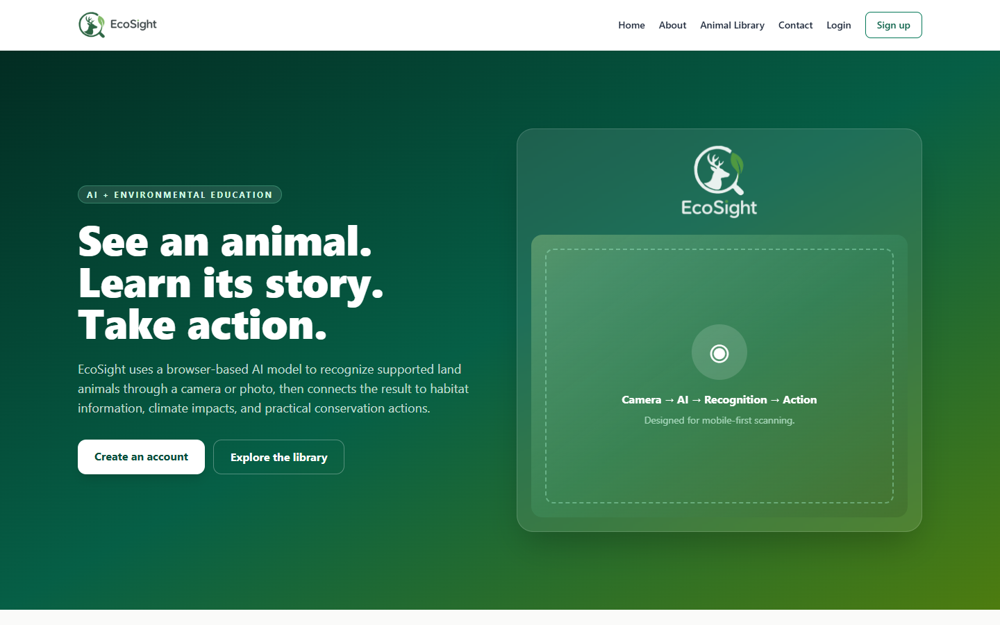
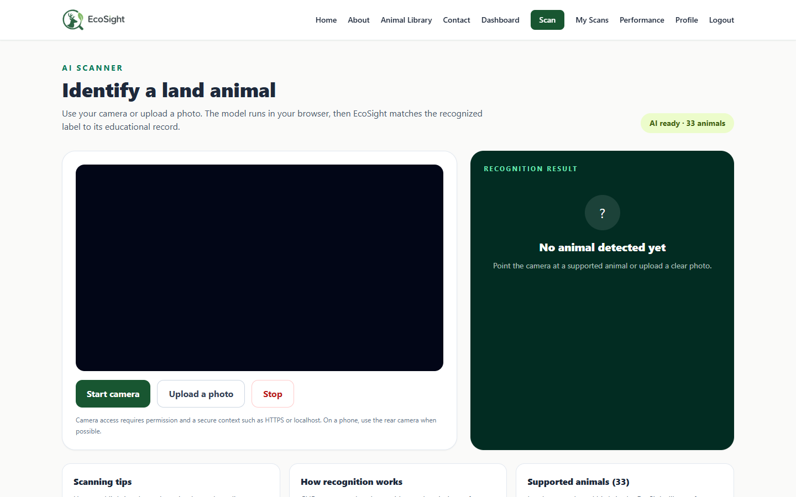
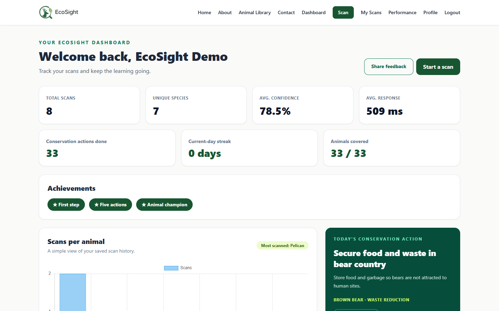
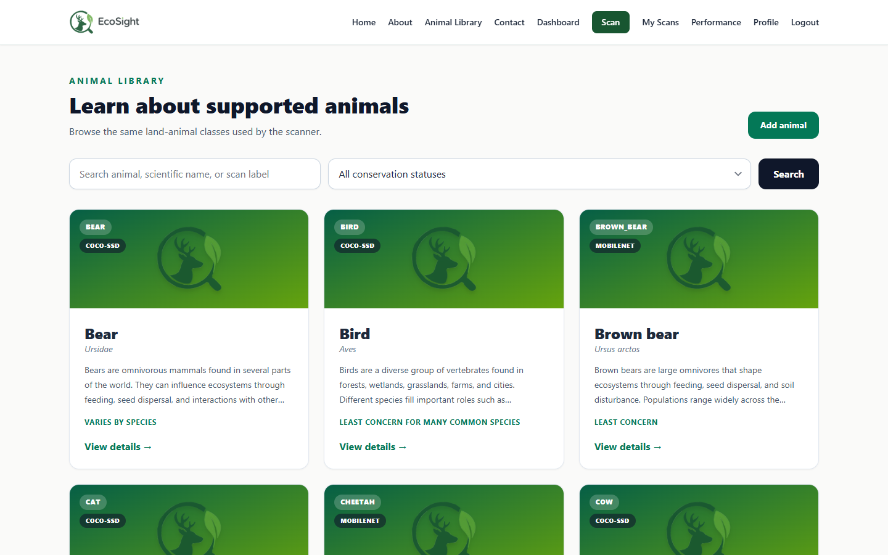
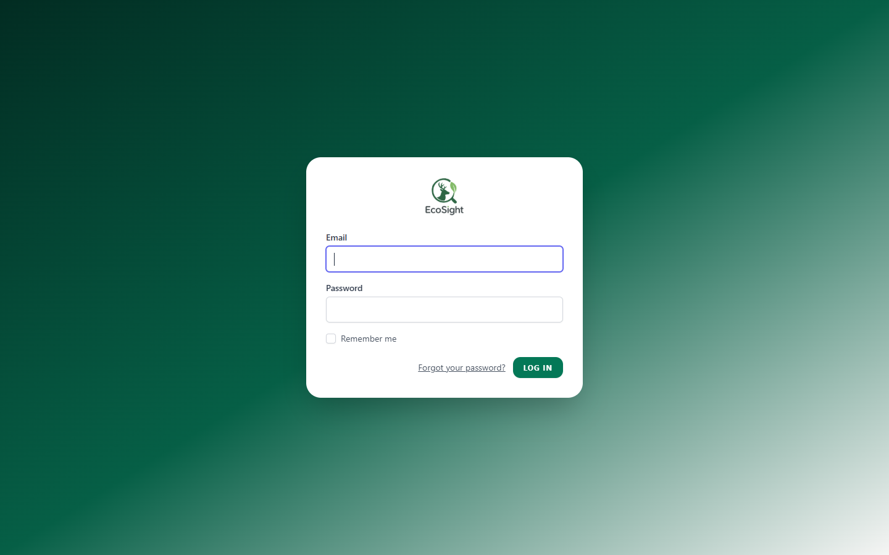

# EcoSight

## EcoSight: An AI-powered Lens for Identifying Land Animals and Promoting Environmental Awareness

EcoSight is a Laravel web application for the ITCC3101 Midterm Practical Exam. It uses a browser camera or uploaded photo with CLIP (Transformers.js) as the primary zero-shot recogniser and a MobileNet group fallback, all running locally in the browser. After recognition, the application displays habitat information, climate-change impacts, conservation status, and practical conservation actions.

The project follows the proposed study's camera → AI processing → recognition result → information display pipeline. The scanner includes loading, camera-permission, no-animal, low-confidence, and model-failure states. Saved scans record confidence, response time, and scan history for later evaluation.

## SDG alignment

- **SDG 4: Quality Education** — provides short, interactive learning content about animals and environmental responsibility.
- **SDG 15: Life on Land** — connects animal recognition to habitat awareness and practical conservation actions.

## Main features

- Real-time camera scanning
- Upload-a-photo fallback
- Camera switch (when multiple devices) and pause/resume detection
- CLIP zero-shot browser-based recognition with progress UI
- MobileNet group fallback, camera stability filter, and distractor rejection
- Open-vocabulary species matching against 3,750 (tier 1) and 20,000 (tier 2) species, with a user-driven "add this species" flow
- Public species information from Wikipedia and Wikidata for species that are not in the library yet
- User-added animals that are marked as "waiting for review" until a reviewer confirms them
- Optional breed/variety suggestions with user confirmation
- Confirmation flow for low-confidence or close-race results
- Educational tips panel and visible list of supported animals
- Animal educational profiles
- Conservation action management
- Conservation action completion tracking ("Mark as done"), today's action, and achievements badges on the dashboard
- Public animal library with authenticated CRUD management, search, and conservation-status filter
- Laravel Breeze registration, login, logout, password hashing, and profile
- User dashboard with scan metrics, Chart.js visualization, streak, and badges
- Personal scan history with date filter, delete, per-scan animal links, and CSV export
- Per-scan result feedback ("Was this result correct?") stored per scan
- Client-side scanner event log (model load, camera start, failures, low confidence)
- Usability survey (4 × 1–5 ratings + comment)
- System performance report with metrics and CSV export
- Contact form with validation and database storage
- Custom logo/branding: logo lockup, icon mark, favicon set, and PWA manifest
- Faker seed data for the custom tables
- Custom 404 and 500 error pages
- Narrative reaction page at `/reflection`

## Technology stack

- Laravel 13
- PHP 8.3+
- Laravel Breeze 2.x with Blade
- Tailwind CSS 4 through the Laravel/Breeze Vite setup
- MySQL
- SQLite fallback
- TensorFlow.js (MobileNet fallback and benchmark baseline)
- Transformers.js 4.3.0 + CLIP ViT-B/32 (q8, browser WASM)
- COCO-SSD (benchmark baseline)
- Chart.js
- Vite
- Wikidata Query Service and the Wikidata/Wikipedia public APIs (species data only)

Laravel 13 was released on March 17, 2026 and requires PHP 8.3. Laravel Breeze 2.4.2 supports Laravel 13. The setup below follows the exam's required `composer create-project`, Breeze Blade, NPM, and Artisan workflow.

## Prerequisites

Install:

- PHP 8.3 or newer
- Composer
- Node.js and npm
- MySQL 8.x or a compatible MySQL/MariaDB server
- Git (optional)
- A modern browser with camera support

## Setup

### 1. Create the Laravel project

```bash
composer create-project laravel/laravel ecosight
cd ecosight
```

### 2. Install Laravel Breeze Blade authentication

```bash
composer require laravel/breeze --dev
php artisan breeze:install blade
```

When the Breeze installer asks for the frontend stack, use the Blade stack. The installer creates the authentication controllers, routes, Blade views, components, profile page, and frontend scaffolding.

### 3. Install frontend dependencies

```bash
npm install
```

### 4. Configure MySQL

Create a database named `ecosight`, then update `.env`:

```env
APP_NAME=EcoSight
APP_ENV=local
APP_KEY=
APP_DEBUG=true
APP_URL=http://localhost:8000

DB_CONNECTION=mysql
DB_HOST=127.0.0.1
DB_PORT=3306
DB_DATABASE=ecosight
DB_USERNAME=root
DB_PASSWORD=
```

For a local XAMPP installation, `DB_USERNAME=root` and an empty `DB_PASSWORD` are common defaults. Use the credentials configured on your own machine if they are different.

### 5. Generate the application key if needed

```bash
php artisan key:generate
```

### 6. Add the EcoSight files

Copy the custom files from this project into the matching Laravel directories. The provided `routes/web.php`, models, controllers, migrations, requests, seeders, views, CSS, scanner JavaScript, and documentation are the EcoSight-specific files.

Do not delete the Breeze-generated `routes/auth.php` or Breeze authentication controllers and views.

### 7. Reset the database and seed it

```bash
php artisan migrate:fresh --seed
```

This creates the Laravel tables plus:

- 33 animals (10 COCO-SSD + 20 wild MobileNet + 3 household pets)
- 16 animal varieties (dog, cat, horse, and cattle breeds) with CLIP prompts
- 89 conservation actions (2 per COCO-SSD animal, 3 per MobileNet-scannable animal)
- 30 scans
- 10 contact messages
- 15 scan feedback responses (half of the seeded scans)
- 24–84 scanner events (4–14 randomized per user)
- 0–12 survey responses (0–2 randomized per user)
- 33–48 action completions: the demo user completes one action for every animal (so all badges are earned), plus 0–3 random per factory user
- 1 demo user
- 5 additional factory users

All animal/action seeders are idempotent (`updateOrCreate` on the scan label /
action title), so re-running `php artisan db:seed` never duplicates the library.

If MySQL is not running locally, seed against SQLite instead:

```powershell
$env:DB_CONNECTION='sqlite'
$env:DB_DATABASE='C:\absolute\path\to\database\database.sqlite'
php artisan migrate:fresh --seed
```

For HTTP smoke tests the SQLite override must reach web requests — run a direct server (`php -S 127.0.0.1:8000 -t public`) rather than `php artisan serve`, which strips env overrides unless `--no-reload` is passed.

### 8. Start Laravel

Terminal 1:

```bash
php artisan serve
```

Terminal 2:

```bash
npm run dev
```

Open:

```text
http://localhost:8000
```

Keep `npm run dev` running while using the Vite-powered styles during development.

## Demo account

```text
Email: demo@ecosight.test
Password: password
```

The password is stored using Laravel's `hashed` cast in the User model, so the plain-text password is not stored in the database.

## Important scanner note

Camera access uses `navigator.mediaDevices.getUserMedia()`. Browsers require a secure context for camera access, with `localhost` treated as a secure development origin. If the camera is denied or unavailable, EcoSight provides the upload-photo fallback.

CLIP is the primary recogniser. The pinned Transformers.js bundle and both CLIP encoders (vision: ~85 MiB, text: ~62 MiB, q8 ONNX) are served same-origin from `public/models/` and `public/vendor/transformers/`; nothing is sent to a third-party AI service and no API key is required. Text vectors for every animal, variety, and distractor prompt are committed in `public/data/clip-text-embeddings.json`, so normal scans load only the vision encoder. If an admin edits an animal clip prompt, the browser detects the stale embeddings from `GET /scanner/labels` and lazily loads the text encoder to recompute them.

Model assets are not committed: run `npm run download:clip` once after cloning (uses curl with retry/resume because some Node TLS setups cannot reach huggingface.co). After editing scan prompts or varieties, run `npm run build:text-embeddings` to refresh the committed text vectors.

Recognition flow:

1. **CLIP zero-shot** scores the frame against text prompts for all 33 animals and 12 non-animal distractor prompts. Camera mode combines three views (centre/left/right at 0.4/0.4/0.2) and requires three stable frames before showing a result. Softmax is applied over cosine similarities scaled by 100.
2. **Decision rules** (each result carries its `rule`, visible with `?debug=1`): `clip` accepts top-1 at 55%+ with a 15% margin; `clip-unsure` asks the user to choose when candidates are within 20% of the leader; `clip-weak` returns a confirmable low-confidence result; `distractor` rejects a confident non-animal scene.
3. **MobileNet group fallback** runs only when CLIP is unavailable or below its save threshold. Top-5 ImageNet classes are collapsed into library animals through `public/data/imagenet-groups.json` (breeds merge into dog, big cats into their species, and so on). `fallback` accepts a group at 50%+ with a 10% margin; `fallback-weak` is confirmable at 40%+.
4. **Agreement** adds a 0.10 bonus when CLIP and the fallback point at the same animal, and promotes a weak CLIP result when the fallback confirms it.
5. **Variety (breed)** scoring runs only for the detected animal, using precomputed variety prompts. A variety is suggested at 45%+ with a 10% margin; the user can always choose another breed or leave it blank.

Save policy is enforced on the server: confident detections save directly; low-confidence or unsure results require `user_confirmed` and must reach 30%. Distractors and classes outside the library can never be saved. Scans store `model_source`, `top2_label`/`top2_confidence`, `user_confirmed`, and the optional variety fields.

Authenticated clients fetch the supported-label list, per-model thresholds, the `mobilenet_map` lookup (lower-cased ImageNet class and each comma synonym -> library label), `clip_prompts`, `varieties`, and `label_names` from `GET /scanner/labels` (cached for a day, cache key `scanner.supported-labels.v6`). The payload also carries a small `library` array (Wikidata id, common name, scientific name) for the open-vocabulary panel, and a `library_version` fingerprint that invalidates the cached payload when animals, varieties, or conservation actions change. Append `?debug=1` to the scanner URL to reveal raw CLIP/fallback scores and the winning rule.

`GET /scanner/benchmark` (authenticated, debug builds only) runs CLIP, the MobileNet group fallback, and COCO-SSD side by side on labelled photos and exports a CSV. Accuracy figures from that page describe only the photos used; the project makes no general accuracy claim.

The benchmark has three modes, chosen above the photo picker:

- **Animal Library** checks CLIP and the fallbacks against the 33 library labels. Pick the expected label from the dropdown.
- **Open vocabulary (Tier 1)** ignores the library labels. Type the expected species name exactly as it appears in the vocabulary (for example `European robin`); the open-vocabulary column shows its top candidates, and the summary counts a hit when the expected name is in the top five.
- **Out-of-scope check** runs the same scoring and reports the strongest out-of-scope prompt (fish, marine mammal, sea turtle), so you can measure how often an excluded animal is recognised as excluded.

For a repeatable run, collect a folder of photos named after the expected species (for example `european-robin-01.jpg`) or record the expected name for each photo before running. Use photos you have the right to evaluate, keep the set unchanged between runs, and note camera, distance, lighting, and crop in the exported CSV context. Do not upload the photos: the benchmark reads them from the browser only.

## Open-vocabulary species matching

The 33-animal library is a teaching set, not a field guide: a European robin or a stag beetle would be reported as "not in the library yet". EcoSight therefore ships a **species vocabulary** that is scored in the browser with the same CLIP image embedding.

| Tier | Species | Size | When it is used |
|---|---|---|---|
| Tier 1 | 3,750 | 1.5 MB metadata + 3.7 MB float16 matrix | Loaded in the background after the scanner starts |
| Tier 2 | 20,000 | 8.7 MB metadata + 9.8 MB int8 matrix | Only on request ("Search 20,000 more species") |

Tier 1 quotas per group: mammals 800, birds 1,300, reptiles 600, amphibians 350, insects 500, arachnids 200. Tier 2 fills the remaining quota evenly across the same six groups, ordering threatened species (CR, EN, VU, NT) ahead of the rest and using Wikipedia sitelinks as the tie-breaker. The scope follows **SDG 15: Life on Land**: mammals, birds, reptiles, amphibians, insects, arachnids, and rare or threatened species. Marine and freshwater animals belong to SDG 14 and are excluded by Wikidata class: fish (including sharks, rays, lampreys, and extinct fish classes), cetaceans (whales, dolphins, porpoises), sirenians (manatees, dugongs), sea turtles, and sea snakes. Fossil-only taxa and species without an English name are also excluded. Other invertebrates are disabled by default so the list stays focused on the named land groups.

The vocabulary is a suggestion aid only. Because the probabilities are CLIP cosine similarities over a shortlist, they are not calibrated field-guide confidence. Use the photo, the Wikipedia summary, and the habitat line to check a suggestion before adding it.

Both tiers ship as a metadata JSON (one row per species) plus a row-major matrix of L2-normalised CLIP text embeddings: float16 for tier 1, int8 with a per-row scale for tier 2. The browser decodes the matrix in a Web Worker (`public/js/open-vocab-worker.js`), so the 20,000-species list never blocks the UI. The extended list is downloaded once, verified against the SHA-256 checksum in the metadata, and kept in IndexedDB (`public/js/open-vocab-store.js`); a cached copy whose checksum no longer matches is discarded.

**How a suggestion becomes a library animal**

1. The library does not recognise the photo, so the scanner scores it against the vocabulary and shows the closest species with their match probability. Tier 1 is scored automatically; Tier 2 is used only after the user chooses **Search 20,000 more species**. If the strongest out-of-scope prompt (fish, marine mammal, sea turtle) wins clearly, the scanner refuses the match instead of offering a land species.
2. Picking a species calls `GET /scanner/lookup/{qid}`, which reads the English Wikipedia summary and the Wikidata statements (cached for 30 days, 5-second timeout, `User-Agent` from `WIKIMEDIA_USER_AGENT`). Only QIDs that exist in the shipped vocabulary are looked up. The response carries the source link and the CC BY-SA 4.0 licence.
3. The review form shows the Wikipedia name, scientific name, group, description (the first three sentences of the article, unmodified), habitat (Wikidata `P2974`), conservation status, and climate impact. The user must confirm the details and write a description if Wikipedia has no summary. The browser can edit these review fields, but the server only accepts a vocabulary QID and validates every field.
4. **Add to the library** creates an animal with `origin = user-added`, `is_reviewed = false`, `added_by` set, `coco_label` set to a unique slug built from the general name and scientific epithet (for example `fox-vulpes-vulpes`), and the two general conservation actions of its group. A QID that is already in the library is rejected with a link to the existing animal.
5. **Add as a type of …** is offered when the species and a library animal share a genus, or when the species name names the library animal. It creates an `animal_varieties` row with `kind = species` instead of a new animal.

A reviewer marks a user-added animal as reviewed from its page, and the review state is what separates user additions from the seeded records. Unreviewed animals show an **Unreviewed** badge in the library and on their page.

The profile page shows whether the extended list is downloaded in this browser, its size, and a button to remove it. The list is optional and never downloaded automatically.

### Rebuilding the vocabulary

```bash
node scripts/build-animal-vocabulary.mjs --tier=both
```

The builder queries the Wikidata Query Service in two stages: a paged pool query per group (ordered by Wikipedia sitelinks, so the best-known species come first) and a batched metadata query. Intermediate results are cached under `storage/app/vocab-cache/` (prefix `v2-`), so a re-run is fast. Useful flags: `--tier=1|2|both`, `--group=mammals,birds` (limit the groups), `--limit=500` (cap the species per group and per tier), `--refresh` (ignore the caches and query again).

The script needs the local CLIP text encoder (`public/models/Xenova/clip-vit-base-patch32`). The committed outputs are `public/data/animal-vocabulary.json` + `animal-vocabulary.f16.bin` (tier 1) and `public/data/animal-vocabulary-extended.json` + `animal-vocabulary-extended.i8.bin` (tier 2).

## Supported animals (33)

| COCO-SSD group (10) | MobileNet wild group (20) | Household pets (3) |
|---|---|---|
| Bear, Bird, Cat, Cow, Dog | Brown bear, Cheetah, Red fox, Gazelle | Guinea pig (`pet_guinea_pig`) |
| Elephant, Giraffe, Horse, Sheep, Zebra | Giant panda, Western gorilla, Jaguar, Kangaroo, Koala | Hamster (`pet_hamster`) |
| | Leopard, Lion, Lynx, Eurasian otter, Pelican | Domestic rabbit (`pet_rabbit`) |
| | King penguin, Polar bear, Red panda, Tiger, Wild boar, Grey wolf | |

The table shows the fallback groups each animal belongs to (`animals.model_source` and `animals.model_labels`); CLIP scores all 33 animals directly from their `clip_names` prompts. `coco_label` is the stable lookup key used by `/scanner/animal/{label}` and the scan save endpoint. Sixteen breeds/varieties (dog, cat, horse, cattle) live in `animal_varieties` with their own `clip_names`.

## Scanner limitations

The scanner is deliberately conservative. Low light, heavy motion blur, tiny or distant animals, and species outside the 33-animal library will not match. Pets can still be confused with wild relatives, and visually similar animals (wolf vs. dog, gazelle vs. deer) are the hardest zero-shot cases; close races become a user choice instead of a wrong automatic answer. Low-confidence results must be confirmed before saving, but confirmation does not guarantee correctness. All prediction code runs locally in the browser; nothing is uploaded until a scan is saved.

The open-vocabulary list widens the coverage, not the certainty: the suggested species is the closest match in the vocabulary for the photo, and the probability shown is the model's similarity, not a calibrated confidence. Always check the Wikipedia summary and the photo before adding a species to the library.

## Logo assets

The brand assets are generated by `scripts/make-logo-assets.php` (PHP 8.4 + GD, no ImageMagick/Python required). A Pillow port, `scripts/make-logo-assets.py` (needs `pip install pillow`), is kept alongside for environments without GD. Re-run `make-logo-assets.php` only if you want to regenerate the assets from `public/images/logo-original.png` (the untouched 2000x2000 source):

```bash
php scripts/make-logo-assets.php
```

| File | Purpose |
|---|---|
| `public/images/logo-original.png` | Untouched backup of the original source artwork |
| `public/images/logo-stacked.png` | Primary stacked lockup (guest/auth screens, `application-logo` component) |
| `public/images/logo-stacked-light.png` | Stacked lockup for dark/green backgrounds (hero, about) |
| `public/images/logo-mark.png` | Icon-only mark, dark (animal card placeholder, error pages) |
| `public/images/logo-mark-light.png` | Icon-only mark for dark/green backgrounds |
| `public/images/logo-wordmark.png` | Wordmark-only lockup |
| `public/images/logo-horizontal.png` | Horizontal lockup for light navbars |
| `public/images/logo-horizontal-light.png` | Horizontal lockup for dark footers |
| `public/images/logo.png` | Copy of the stacked lockup, kept for compatibility |
| `public/favicon.ico` | Favicon container (16/32/48 px) |
| `public/favicon.png` / `public/favicon-192.png` | 32 px / 192 px favicons |
| `public/apple-touch-icon.png` | 180 px iOS home-screen icon |
| `public/manifest.webmanifest` | PWA manifest (theme `#185631`, standalone) |
| `resources/views/components/head.blade.php` | Shared head: favicons, meta/OG/Twitter tags, manifest, theme-color |

Brand colors live in `tailwind.config.js` under `theme.extend.colors.brand`: `dark #185631`, `leaf #5EA73B`, `ink #202C2E`. The logo wordmark typeface is matched to **Outfit SemiBold** (see `scripts/_fontmatch.php`); the font is self-hosted as `public/fonts/outfit-semibold.woff2` and exposed to Tailwind as `font-brand`. Body copy keeps the Figtree stack.

## Routes

| Route | Access | Purpose |
|---|---|---|
| `/` | Public | Landing page |
| `/about` | Public | Study overview |
| `/animals` | Public | Animal library (search + status filter) |
| `/animals/{animal}` | Public | Animal details |
| `/contact` | Public | Contact form (POST `throttle:10,1`) |
| `/login` | Public | Breeze login |
| `/register` | Public | Breeze registration |
| `/dashboard` | Auth | User statistics, streak, badges, today's action |
| `/scanner` | Auth | Camera/photo AI scanner |
| `POST /scanner/scan` | Auth | Save a scan (CLIP 0.50, confirmed 0.30, MobileNet 0.40, COCO 0.60; `throttle:10,1`) |
| `GET /scanner/animal/{label}` | Auth | Animal record lookup for a recognized label |
| `GET /scanner/lookup/{qid}` | Auth | Wikipedia/Wikidata summary for a suggested species (30-day cache) |
| `GET /scanner/benchmark` | Auth + debug | CLIP / MobileNet / COCO-SSD labelled-photo benchmark |
| `POST /scanner/event` | Auth | Client-side scanner events (`throttle:60,1`) |
| `/scans` | Auth | User scan history (date filter) |
| `GET /scans/export` | Auth | CSV export of the current user's scans |
| `POST /scans/feedback` | Auth | Per-scan result feedback (`throttle:10,1`) |
| `/survey` | Auth | Usability survey (GET/POST, `throttle:10,1`) |
| `/performance` | Auth | System performance report (all users) |
| `/performance/csv` | Auth | Performance report CSV |
| `POST /actions/{action}/complete` | Auth | Mark a conservation action as done (`throttle:30,1`) |
| `DELETE /actions/{action}/complete` | Auth | Undo a completed conservation action |
| `/animals/create` | Auth | Create animal |
| `POST /animals/from-scan` | Auth | Add a suggested species to the library as a user-added animal (`throttle:10,1`) |
| `POST /animals/{animal}/varieties` | Auth | Add a suggested species as a variety of a library animal (`throttle:10,1`) |
| `PATCH /animals/{animal}/review` | Auth | Mark a user-added animal as reviewed |
| `/animals/{animal}/edit` | Auth | Edit animal and actions |
| `/profile` | Auth | Breeze profile |
| `/reflection` | Public | Narrative reaction |

## Documentation

- `docs/USER_MANUAL.md` — end-user manual: installation, signup, scanning, feedback, survey, conservation actions, camera troubleshooting.
- `docs/BUG_LOG.md` — bugs found during development with file, cause, and fix for each.

## Tests

```bash
php artisan test
npm run test:js
```

95 PHP tests (444 assertions) covering Breeze auth and profile, guest-access redirects, scan saving validation (CLIP thresholds, user confirmation, variety ownership, unsupported labels), scan-feedback ownership, scanner event allow-listing, survey validation, action-completion uniqueness, performance report/CSV scoping (own scans only), the `animals/create` route-order regression, the benchmark debug gate, animal-library search/filter hardening, the `/scanner/labels` payload (including `mobilenet_map`, `clip_prompts`, `varieties`, and the `library_version` cache key), record lookup for every scannable label, and the open-vocabulary flow (species lookup, add to library, add as a variety, duplicate rejection, review state, and general conservation actions). Tests run against in-memory SQLite (`phpunit.xml`). The browser smoke test (`npm run test:browser`) loads the real CLIP vision encoder in headless Chrome.

70 plain-Node tests cover the pure scanner decision module (`public/js/scanner-logic.js`) the open-vocabulary core (`public/js/open-vocab-core.js`), and the vocabulary store (`public/js/open-vocab-store.js`): candidate filtering (confidence, box area, edge-thin, ranking), the `mobilenet_map` label mapping, all reconcile rules (`agree`, `mobile-override`, `uncertain`, `coco-candidate`, `whole-image`, `not-in-library`, `low-confidence`, `none`), the tier-1/tier-2 ranking and combined top-5 behaviour, and the vocabulary download checksum verification.

## Screenshots











## Suggested demo flow

1. Open the home page.
2. Register a new account or use the demo account.
3. Open the scanner.
4. Allow camera access or upload a clear animal image.
5. Show the loading and detection states.
6. Show the bounding box and confidence.
7. Scan a species that is not in the library (for example a bird or an insect) and show the open-vocabulary suggestions, open one for its Wikipedia summary, and add it to the library as a user-added animal.
8. Show habitat, climate impact, and conservation actions.
9. Click **Save scan**, then answer the **Was this correct?** Yes/No prompt.
10. Show pause/resume and (with two cameras) the camera-switch button; open the tips panel.
11. Open **My Scans**, filter by date, and export the CSV.
12. Open **Dashboard** and show the metrics, chart, streak, badges, and today's action — mark it as done.
13. Open **Animal Library**, filter by conservation status, and mark an animal's action as done from its page (undo it). Open the user-added animal and mark it as reviewed.
14. Complete the **Usability survey** from the dashboard header link.
15. Open **Performance** and show the report metrics, charts, and CSV downloads.
16. Log out and verify that protected pages redirect to login.

## Credits

- Laravel and Laravel Breeze for the application framework and authentication scaffolding.
- TensorFlow.js and the COCO-SSD model for client-side object detection.
- Chart.js for the dashboard chart.
- José Rizal University, BSIT, ITC C301-303I Integrative Programming and Technologies 1.

## Academic note

EcoSight's COCO-SSD recognition is a classroom implementation and should not be treated as a wildlife-identification authority. Recognition confidence can vary with lighting, framing, distance, and image quality. The application therefore records confidence and response time and provides explicit low-confidence and failure states.


